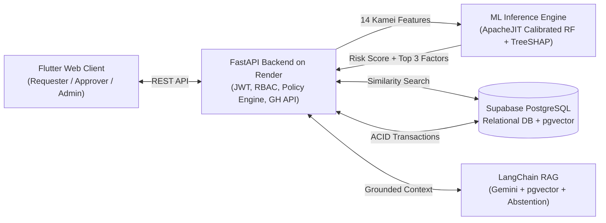

# Change Risk Prediction & Approval System

[](https://www.python.org/downloads/)
[](https://fastapi.tiangolo.com)
[](https://scikit-learn.org/)
[](https://www.postgresql.org/)
[](https://github.com/pgvector/pgvector)
[](https://flutter.dev)
[](https://opensource.org/licenses/MIT)

> An enterprise IT change governance and risk prediction platform (ServiceNow Change Management style) that predicts the failure risk of code and deployment changes before they ship.

---

## 📌 Overview

In enterprise IT operations, production infrastructure and software changes are the primary source of unplanned outages. This platform provides an end-to-end change governance engine:

1. **Predictive Failure Assessment**: Evaluates change failure risk before deployment using a calibrated machine learning pipeline trained on the [ApacheJIT benchmark](https://doi.org/10.5281/zenodo.5907001) ($106,674$ commits across 14 Apache projects with time-based validation).
2. **Explainable AI (TreeSHAP)**: Identifies the top 3 contributing risk factors (e.g. change sprawl/entropy, lines added, author subsystem familiarity) per request.
3. **Dual Ingestion**: Submit change metrics manually or automatically extract diff statistics directly from a GitHub Pull Request / Commit URL.
4. **Policy Enforcement**: Automatically checks for company blackout windows and enforces mandatory rollback plans for High-Risk changes.
5. **Runbook Intelligence (RAG)**: LangChain pipeline with Supabase `pgvector` that matches change descriptions against operational runbooks, with strict evidence abstention (`NO_EVIDENCE`) when no matching documentation exists.
6. **Audit & Outcomes**: Immutable audit logging and tracking of post-deployment outcomes (`Success`, `Rollback`, `Incident`) for governance compliance.

---

## 🏗️ Architecture



---

## ✨ Key Features

- **Multi-Role Governance (JWT / RBAC)**: Strict segregation of duties for `requester`, `approver`, and `admin`. Requesters cannot approve their own changes.
- **14 Kamei JIT Metrics**: Captures Diffusion (`NS`, `ND`, `NF`, `Entropy`), Churn (`LA`, `LD`, `LT`), Purpose (`FIX`), History (`NDEV`, `AGE`, `NUC`), and Developer Experience (`EXP`, `REXP`, `SEXP`).
- **Leak-Free Temporal Validation**: Trained strictly on 14 years of historical commits (2003–2016) and evaluated out-of-time on the final 3 years (2017–2019) to prevent lookahead bias.
- **Calibrated Probabilities**: Platt Scaling (`CalibratedClassifierCV`) transforms raw model scores into true empirical probabilities mapped to justified risk tiers:
  - 🟢 **Low Risk** ($P < 0.20$): Pre-authorized / standard deployment
  - 🟡 **Medium Risk** ($0.20 \le P < 0.45$): Peer review required
  - 🔴 **High Risk** ($P \ge 0.45$): Mandatory CAB approval & verified rollback plan
- **Grounded Runbook Advisory**: Strict similarity threshold ($0.65$) ensuring the RAG pipeline abstains rather than hallucinating destructive rollback commands.
- **Full-Stack Dashboard**: Responsive Flutter Web client covering change submission, approval queues, SHAP cards, and outcome tracking.

---

## 📊 Dataset & Evaluation (ApacheJIT)

This system is benchmarked on **ApacheJIT** ([arXiv:2203.00101](https://arxiv.org/abs/2203.00101)), a peer-reviewed dataset from MSR 2022:

| Metric | Dataset Specification |
| :--- | :--- |
| **Total Commits** | 106,674 software changes across 14 Apache projects |
| **Ground Truth** | SZZ algorithm linking Jira issue tickets to bug-inducing commits |
| **Class Distribution** | 28,239 bug-inducing ($\approx 26.47\%$), 78,435 clean commits |
| **Time Split** | Train: 2003–2016 (14 years) \| Test: 2017–2019 (3 years, natural distribution) |
| **Primary Metric** | **PR-AUC** evaluated against the **$0.26$ positive prevalence baseline** |

*Note: The pipeline is designed to be retrained on an enterprise's own internal change and incident history.*

---

## 📁 Repository Structure

```
├── docs/                        # Core system architecture & data specifications
│   ├── architecture.md          # Database schema, API contracts & system diagrams
│   ├── data_plan.md             # Kamei feature dictionary & time-split rationale
│   ├── workflow.md              # 28-day roadmap, git branching & experiment logging
│   └── risks.md                 # Failure mode analysis & mitigation matrix
├── data/
│   ├── apachejit/               # Benchmark dataset ingestion scripts
│   ├── runbooks/                # Markdown operational runbooks & incident post-mortems
│   └── eval/                    # 15-query golden RAG evaluation set
├── ml_pipeline/                 # Scikit-learn preprocessing, training & TreeSHAP
├── backend/                     # FastAPI REST API (JWT, RBAC, policy rules, pgvector RAG)
├── frontend/                    # Flutter Web application
├── .env.example                 # Environment configuration template
└── README.md
```

---

## 📖 Technical Documentation

Detailed engineering blueprints and specifications are maintained in the `/docs` directory:
- [**System Architecture & Database Schemas (`docs/architecture.md`)**](docs/architecture.md)
- [**Data Plan, Features & Leakage Prevention (`docs/data_plan.md`)**](docs/data_plan.md)
- [**Development Workflow & Logging Guide (`docs/workflow.md`)**](docs/workflow.md)
- [**Risk Assessment & Failure Modes Matrix (`docs/risks.md`)**](docs/risks.md)

---

## 🚀 Quickstart

### Prerequisites
- Python 3.11+
- PostgreSQL 15+ (or free [Supabase](https://supabase.com) instance with `pgvector` enabled)
- Flutter SDK (3.x+)

### Backend Setup
```bash
# 1. Clone repository
git clone https://github.com/Ad895731/change_risk-prediction-system1.git
cd change_risk-prediction-system1

# 2. Setup Python environment
python3 -m venv venv
source venv/bin/activate
pip install -r backend/requirements.txt

# 3. Configure environment
cp .env.example .env
# Edit .env with your Supabase DATABASE_URL and GEMINI_API_KEY

# 4. Run database migrations
cd backend
alembic upgrade head

# 5. Start development server
uvicorn app.main:app --reload --port 8000
```
API Documentation will be live at: `http://localhost:8000/docs`

### Frontend Setup (Flutter Web)
```bash
cd frontend
flutter pub get
flutter run -d chrome
```

---

## 📄 License
This project is licensed under the [MIT License](LICENSE).

