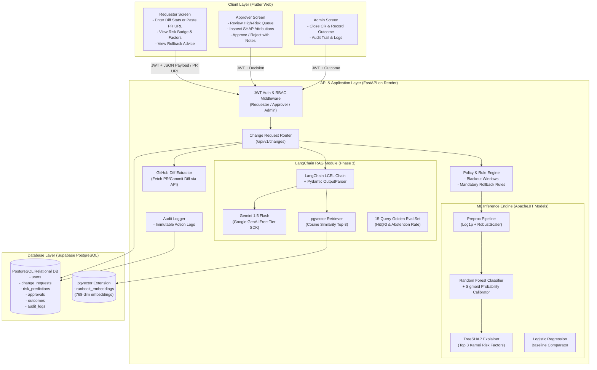

# System Architecture & Technical Design (ApacheJIT Powered)

## 1. Executive Summary & ITIL Change Context
In enterprise IT operations (ITIL v4 and ServiceNow Change Management), changes to production infrastructure (e.g. database migrations, microservice deployments, configuration updates) are the leading cause of unplanned outages.

This platform implements an intelligent **predictive change governance engine**:
1. When an engineer submits a Change Request (CR), change metrics can be provided in two ways:
   - **Manual entry** of Kamei commit/diff stats (`la`, `ld`, `nf`, `ns`, `entropy`, etc.).
   - **Automated ingestion** via GitHub API by submitting a GitHub Pull Request or Commit URL (e.g., `https://github.com/owner/repo/pull/123`), from which diff statistics and file distributions are extracted automatically.
2. A calibrated ML model trained on **ApacheJIT** ($106,674$ commits across 14 Apache projects with a strict 2003–2016 vs. 2017–2019 time split) predicts the failure probability ($P(\text{failure})$) and categorizes it into **Low**, **Medium**, or **High** risk with justified thresholds.
3. Top risk factors are computed dynamically via **TreeSHAP** (or Logistic Regression odds ratios) and returned with the prediction.
4. If High Risk is predicted, the platform enforces mandatory rollback plan requirements and routes the CR to designated CAB (Change Advisory Board) approvers.
5. In Phase 3, a grounded **LangChain RAG pipeline** indexes public runbooks and past incident post-mortems via **pgvector** on Supabase to suggest rollback procedures and mitigation steps. The pipeline strictly abstains with `"NO_EVIDENCE"` when no relevant runbook exists and is benchmarked on a **15-query golden set** using retrieval metrics (Hit@3).
6. Once deployed, the actual outcome is recorded, feeding an audit trail for retrospective model evaluation and governance compliance.

---

## 2. End-to-End System Architecture



---

## 3. Data Flow & Component Lifecycle

### A. Change Request Submission & Risk Assessment Flow
1. **Input Submission**:
   - **Option 1 (Manual)**: Requester fills title, planned start/end, service tier, rollback plan, and Kamei metrics (`la`, `ld`, `nf`, `ns`, `entropy`, etc.).
   - **Option 2 (GitHub PR/Commit URL)**: Requester provides a GitHub URL (e.g. `https://github.com/org/repo/pull/42`). FastAPI calls GitHub API (`GET /repos/{owner}/{repo}/pulls/{number}` and `/files`) to extract `la` (additions), `ld` (deletions), `nf` (changed files count), file directories, and compute `entropy`.
2. **Deterministic Policy Check**:
   - Check if `planned_start` falls within an active company `blackout_window` (e.g., quarter-end freeze).
   - If `is_blackout_window == True`, flag immediate policy warning.
3. **ML Risk Scoring**:
   - Features passed through `scikit-learn` Pipeline (`Log1p` and `RobustScaler`).
   - Calibrated Random Forest model computes $P(\text{failure}) \in [0.0, 1.0]$.
   - Mapped to risk tiers with justified thresholds:
     - **Low**: $P(\text{failure}) < 0.20$ (Pre-approved / standard)
     - **Medium**: $0.20 \le P(\text{failure}) < 0.45$ (Peer review required)
     - **High**: $P(\text{failure}) \ge 0.45$ (Mandatory CAB review & rollback plan verification)
   - `TreeExplainer` (or LR coefficients) calculates local feature attribution, returning top 3 risk factors (e.g. `["Entropy (+0.21)", "Lines Added (+0.14)", "Author Subsystem Experience (-0.10)"]`).
4. **Policy Enforcement on High Risk**:
   - If risk is `High` and `rollback_plan` is empty or under 20 words, the API rejects submission with HTTP 422: `"High-risk change requests require a comprehensive rollback plan."`
5. **Persistence & Audit**:
   - CR created in `change_requests` table with status `Under_Review`.
   - Score and top factors stored in `risk_predictions`.
   - Action logged to `audit_logs`.

### B. Approval & Decision Flow
1. **Review**: Approver logs into Flutter Web, sees queue sorted by `risk_level` (High priority first).
2. **Inspection**: Approver inspects predicted probability, top SHAP factors, and attached rollback steps.
3. **Decision**: Approver submits `approve` or `reject` with mandatory comments.
4. **State Transition**: CR state transitions to `Approved` or `Rejected`. An audit record is written.

### C. Outcome Reporting (Actual Deployment Feedback)
1. **Deployment Completion**: Once deployment finishes, an Admin or Deployment Lead records actual outcome:
   - `Success` (Deployed without incident)
   - `Failed_Rollback` (Deployment failed, rolled back successfully)
   - `Failed_Incident` (Deployment caused a P1/P2 production incident)
2. **Metrics & Audit**: Feeds back into historical reporting (enabling offline retraining, confusion matrix validation, and model drift detection).

### D. RAG Advisory Flow with Abstention (Phase 3)
1. Requester triggers `/api/v1/changes/{id}/rag-advice`.
2. System embeds change description via Gemini embeddings and queries `runbook_embeddings` via `pgvector` ($K=3$).
3. **Abstention Gate**: If top similarity score $< 0.65$, pipeline abstains immediately without invoking the LLM:
   `{ "recommendation": "NO_EVIDENCE: No matching verified runbook found in repository. Manual CAB architectural review required.", "suggested_rollback_steps": [], "sources": [] }`.
4. If similarity $\ge 0.65$, LangChain LCEL pipeline feeds context into Gemini 1.5 Flash with strict Pydantic parsing:
   `{ "recommendation": str, "suggested_rollback_steps": List[str], "sources": List[str] }`.
5. Evaluated against a **15-query golden set** measuring Hit@3 and Abstention accuracy.

---

## 4. Database Schema (PostgreSQL on Supabase)

```mermaid
erDiagram
    USERS ||--o{ CHANGE_REQUESTS : "authors"
    USERS ||--o{ APPROVALS : "decides"
    USERS ||--o{ AUDIT_LOGS : "triggers"
    CHANGE_REQUESTS ||--o{ RISK_PREDICTIONS : "has"
    CHANGE_REQUESTS ||--o{ APPROVALS : "receives"
    CHANGE_REQUESTS ||--o| CHANGE_OUTCOMES : "records"
    CHANGE_REQUESTS ||--o{ AUDIT_LOGS : "logs"

    USERS {
        uuid id PK
        string email UK
        string hashed_password
        string role "requester | approver | admin"
        string full_name
        timestamp created_at
    }

    CHANGE_REQUESTS {
        uuid id PK
        string title
        text description
        string change_type "Standard | Normal | Emergency"
        string service_tier "Tier1 | Tier2 | Tier3"
        string impacted_service
        string github_pr_url "Optional PR URL"
        int ns "Subsystems touched"
        int nd "Directories touched"
        int nf "Files touched"
        float entropy "Change sprawl"
        int la "Lines added"
        int ld "Lines deleted"
        int lt "Lines total"
        boolean fix "Is bug fix"
        int exp "Author total exp"
        float rexp "Author recent exp"
        int sexp "Author subsystem exp"
        float age "Days since last change"
        int ndev "Past devs count"
        int nuc "Unique changes count"
        timestamp planned_start
        timestamp planned_end
        boolean is_blackout_window
        text rollback_plan
        text test_evidence
        uuid author_id FK
        string status "Draft | Submitted | Under_Review | Approved | Rejected | Closed"
        timestamp created_at
        timestamp updated_at
    }

    RISK_PREDICTIONS {
        uuid id PK
        uuid change_request_id FK
        string model_version "apachejit_rf_v1"
        float failure_probability
        float calibrated_score
        string risk_level "Low | Medium | High"
        jsonb top_risk_factors
        timestamp created_at
    }

    APPROVALS {
        uuid id PK
        uuid change_request_id FK
        uuid approver_id FK
        string decision "Approved | Rejected"
        text comments
        timestamp decided_at
    }

    CHANGE_OUTCOMES {
        uuid id PK
        uuid change_request_id FK UK
        string actual_status "Success | Failed_Rollback | Failed_Incident"
        boolean incident_p1_p2
        int downtime_minutes
        text post_mortem_notes
        uuid recorded_by FK
        timestamp recorded_at
    }

    AUDIT_LOGS {
        uuid id PK
        string entity_type "change_request | approval | outcome"
        uuid entity_id
        string action "CREATED | PREDICTED | APPROVED | REJECTED | CLOSED"
        uuid performed_by FK
        jsonb payload_before
        jsonb payload_after
        timestamp timestamp
    }

    RUNBOOK_EMBEDDINGS {
        uuid id PK
        string title
        string service_category
        text chunk_content
        vector embedding "768-dim pgvector"
        jsonb metadata
        timestamp created_at
    }
```

---

## 5. API Contracts (FastAPI REST Endpoints)

### A. Authentication
- `POST /api/v1/auth/register` $\rightarrow$ `{ "id": "uuid", "email": "dev@company.com", "role": "requester" }`
- `POST /api/v1/auth/login` $\rightarrow$ `{ "access_token": "jwt.token.string", "token_type": "bearer", "role": "requester" }`

### B. Change Requests
- `POST /api/v1/changes` (Requester)
  - Accepts either manual Kamei fields or `github_pr_url`.
  - Returns: Change details + calibrated prediction + top 3 factors.
- `POST /api/v1/changes/parse-pr`
  - Body: `{ "pr_url": "https://github.com/apache/kafka/pull/1234" }`
  - Response: `{ "la": 320, "ld": 45, "nf": 6, "entropy": 0.74, "files": [...] }`
- `GET /api/v1/changes`: List with status/risk filtering.
- `GET /api/v1/changes/{id}`: Detailed change request view.

### C. Approvals & Outcomes
- `POST /api/v1/changes/{id}/decision` $\rightarrow$ `{ "decision": "Approved", "comments": "Rollback plan verified." }`
- `POST /api/v1/changes/{id}/outcome` $\rightarrow$ `{ "actual_status": "Success", "incident_p1_p2": false, "downtime_minutes": 0 }`

### D. RAG Runbook Advisory (Phase 3)
- `POST /api/v1/changes/{id}/rag-advice`
  - Response 200 (Found):
    ```json
    {
      "change_id": "7f8b9a12-...",
      "recommendation": "High sprawl detected across 3 subsystems. Verify backward compatibility on header parsing.",
      "suggested_rollback_steps": [
        "Execute 'helm rollback ingress-gateway' to prior revision.",
        "Verify Envoy route table drain status (Target RTO: 3 mins).",
        "Run health check probe on auth middleware endpoint."
      ],
      "sources": ["runbooks/ingress_gateway_rollback_sop.md"]
    }
    ```
  - Response 200 (Abstain when no evidence):
    ```json
    {
      "change_id": "7f8b9a12-...",
      "recommendation": "NO_EVIDENCE: No matching verified runbook found in repository. Manual CAB architectural review required.",
      "suggested_rollback_steps": [],
      "sources": []
    }
    ```

---

## 6. Repository Folder Structure

```
├── .github/
│   └── workflows/ci.yml
├── docs/                        # Complete architecture and planning documents
│   ├── architecture.md
│   ├── data_plan.md
│   ├── workflow.md
│   ├── risks.md
│   ├── phases.md
│   ├── learning_map.md
│   └── resume_bullets.md
├── data/
│   ├── apachejit/               # Real ApacheJIT dataset files from Zenodo
│   │   ├── download_data.py     # Script to fetch Zenodo archive
│   │   ├── apachejit_train.csv  # 2003-2016 historical train partition
│   │   └── apachejit_test_large.csv # 2017-2019 unbalanced test partition
│   ├── runbooks/                # Markdown runbooks for Phase 3 RAG
│   │   ├── ingress_gateway_rollback_sop.md
│   │   ├── db_migration_sop.md
│   │   └── k8s_deployment_runbook.md
│   └── eval/
│       └── golden_queries.json  # 15-query golden evaluation set with ground truth
├── ml_pipeline/
│   ├── features.py              # Log1p and RobustScaler ColumnTransformer
│   ├── train.py                 # Logistic Regression & Random Forest
│   ├── calibrate.py             # CalibratedClassifierCV (Platt / Sigmoid)
│   ├── evaluate.py              # PR-AUC against 0.26 baseline, Recall at 80% Precision
│   ├── explain.py               # TreeSHAP & Logistic Regression coefficients
│   └── artifacts/               # Serialized model pickles
├── backend/                     # FastAPI Application
├── frontend/                    # Flutter Web Application
└── README.md
```
